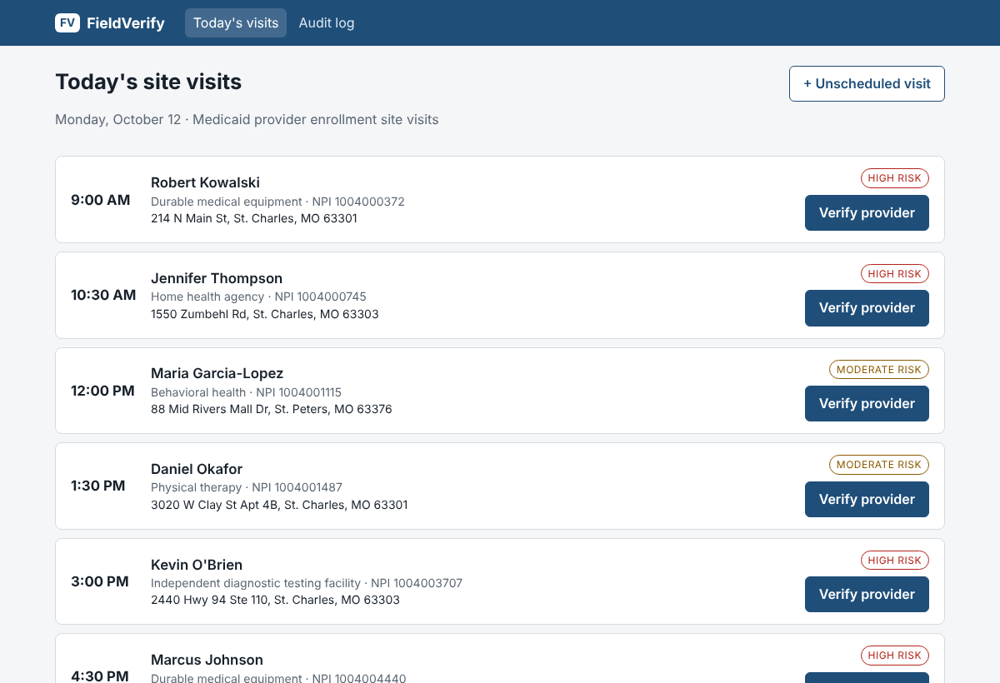
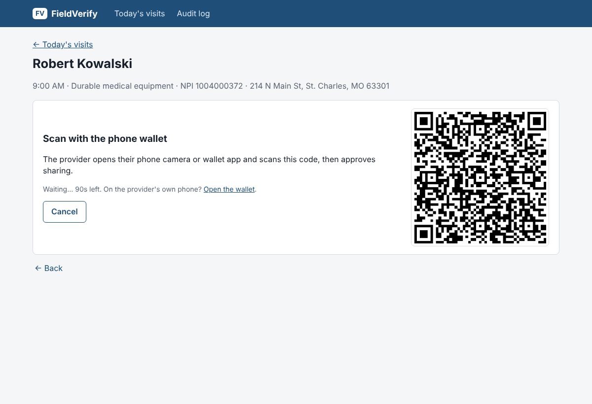
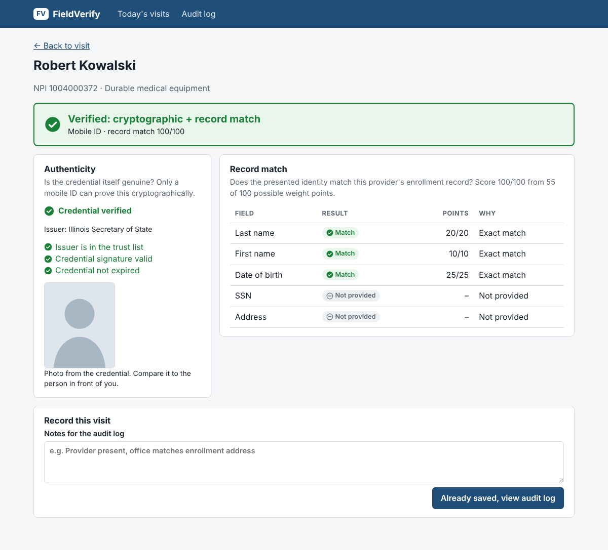
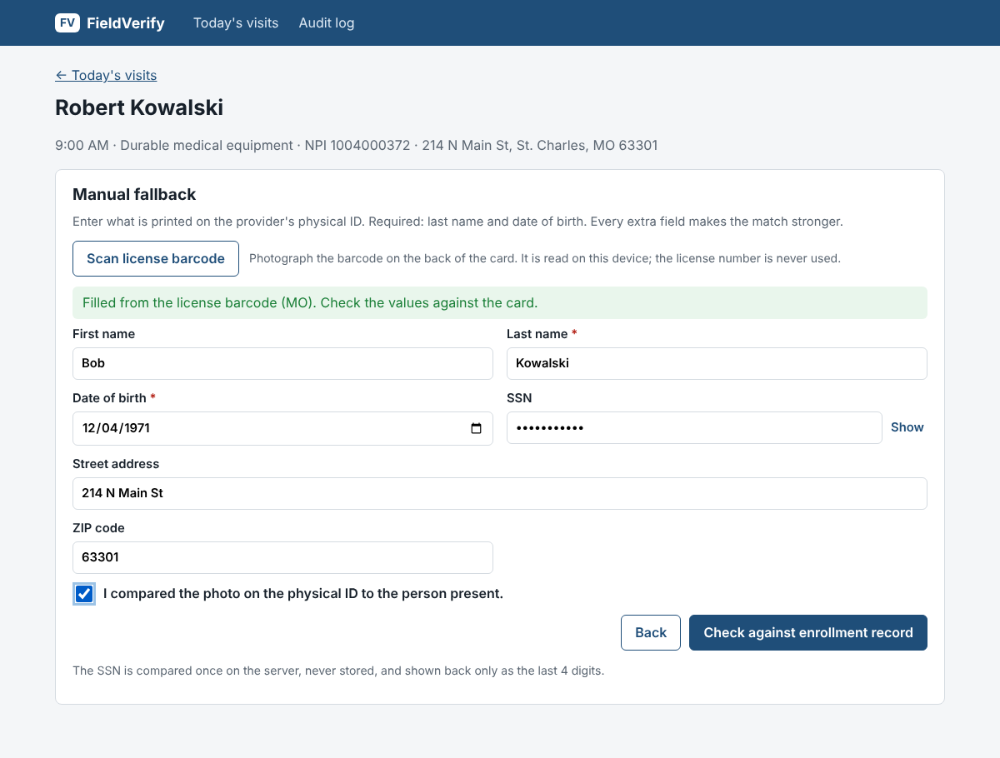
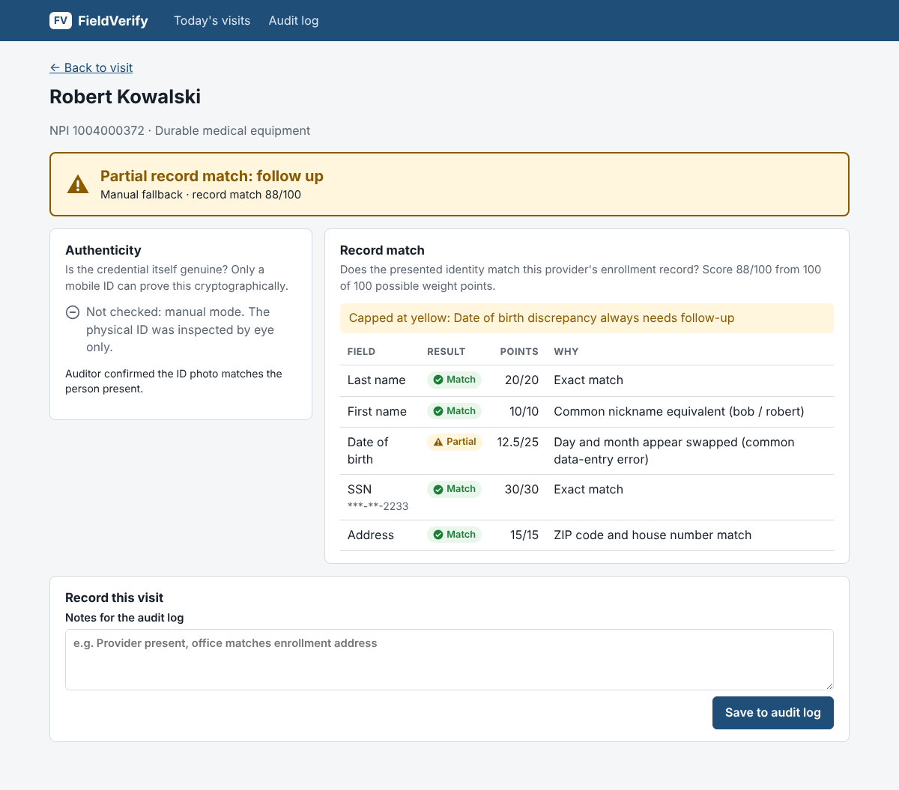
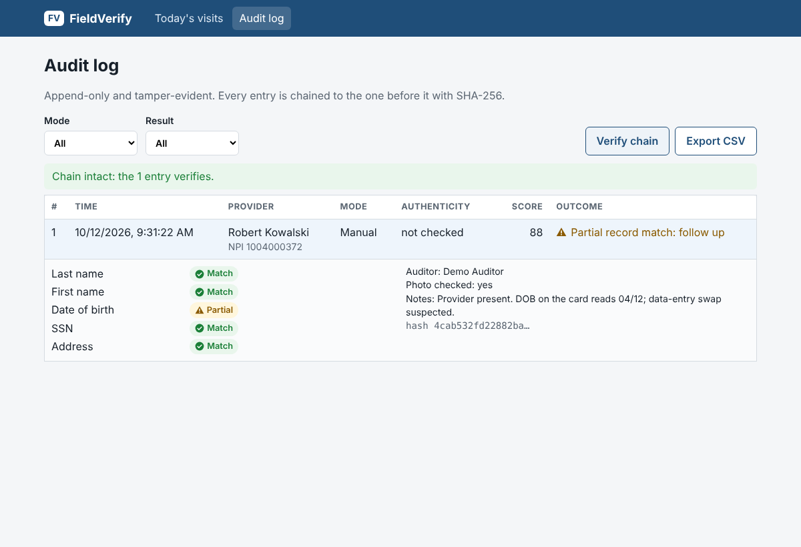
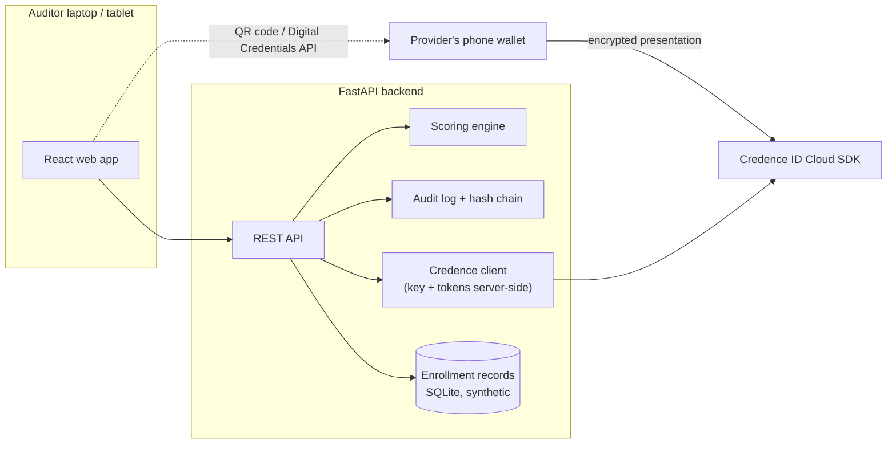

# FieldVerify

**Provider identity verification for Medicaid site visits, built on the Credence ID Cloud SDK.**

State Medicaid agencies must visit moderate- and high-risk providers before and after enrollment, and every enrolled
provider must allow unannounced inspections ([42 CFR 455.432](https://www.ecfr.gov/current/title-42/chapter-IV/subchapter-C/part-455/subpart-E/section-455.432)).
At the door, an auditor needs to answer one question: *is the person in front of me the enrolled provider?*

FieldVerify answers it on a laptop or tablet browser and leaves an audit record the agency can rely on:

- **Mobile ID (primary).** The provider shares the ID in their phone wallet. Credence ID verifies it
  cryptographically: issuer in the trust list, signatures valid, not expired. FieldVerify then matches the shared
  name and date of birth against the provider's enrollment record.
- **Manual fallback.** No wallet ID, dead phone? The auditor scans the PDF417 barcode on the back of the physical
  license (or types the details), confirms the photo, and gets a scored **record match**, clearly labelled as *not*
  cryptographically verified.
- **Tamper-evident audit log.** Every outcome is chained with SHA-256. Editing or deleting any row is detected.
  Exportable to CSV.

| Visits | Mobile ID (QR) | Verified |
|---|---|---|
|  |  |  |

| License barcode → manual form | Manual result (yellow: DOB swapped) | Audit log, chain verified |
|---|---|---|
|  |  |  |

*The verified mobile-ID screenshot uses a stubbed Credence response; all other screens are the live app.*

**Live demo:** https://fieldverify-avyq.onrender.com (free hosting, so the first load after idle takes ~50 s).
All provider data is synthetic.

## How it decides

Two signals, never merged into one number:

| Signal | Question | Source |
|---|---|---|
| **Authenticity** | Is the credential genuine and unaltered? | Credence ID (mobile ID only) |
| **Record match** | Does it match this provider's enrollment record? | FieldVerify scoring engine (both modes) |

| Field | Weight | Full credit | Partial credit |
|---|---|---|---|
| Last name | 20 | exact, or a recorded former/maiden name | typo (Jaro-Winkler ≥ 0.88), one part of a hyphenated name |
| First name | 10 | exact, or a nickname (Bob = Robert) | typo |
| Date of birth | 25 | exact | day/month swapped, or one digit off |
| SSN (manual only) | 30 | exact | two adjacent digits transposed |
| Address | 15 | ZIP + house number | ZIP only |

**Working with Credence's default Age Check profile.** That profile shares the credential's issuer, photo and an
age attestation, but no name or date of birth. FieldVerify shows the credential as genuine and asks the auditor to
confirm the photo and take name + DOB from the physical ID (barcode scan). The result says exactly that:
"Credential genuine + photo confirmed; ID details match record". The fully wallet-attested
"Verified: cryptographic + record match" appears only when the profile shares name and DOB
([ADR-0007](docs/decisions/0007-age-check-profile-completion.md)).

Fields that weren't provided are left out of the denominator. Green ≥ 85, yellow 60–84, red < 60. Rules on top:
a typo never earns full credit; any DOB or SSN discrepancy caps the result at yellow; DOB *and* SSN both wrong, or
both names wrong, is red; and **a manual result can never be labelled "Verified"**. Full rules:
[`docs/spec.md`](docs/spec.md) §3 and §5.

## Architecture



- The **Credence license key never reaches the browser**. The backend owns it and the token lifecycle; the browser
  only shows a QR code or calls `navigator.credentials.get()`.
- Credence answers "is this credential genuine, and what does it say?" FieldVerify answers "is this the enrolled
  provider?" using the agency's own records. Credence holds no provider data.
- Three wallet paths are wired: **QR / deep link** (OpenID4VP, any phone wallet), **Google Wallet** and **Apple
  Wallet** via the browser's Digital Credentials API.
- More: [`docs/architecture.md`](docs/architecture.md), decisions in [`docs/decisions/`](docs/decisions/).

## Privacy and security choices

- **SSN:** masked input, compared once in memory, never logged or stored, shown back only as the last 4 digits.
  Validation errors are rewritten so they can't echo it back.
- **Audit log:** stores per-field outcomes (match / partial / no match), never raw SSN, DOB or the ID photo.
  Append-only API plus a hash chain.
- **Mobile ID:** only the fields the matching needs are requested, with intent-to-retain = false. The photo is held
  in memory for the result screen only.
- **License barcode:** decoded entirely on the device; the license number is never read.
- **Provider lookup** (unannounced visits) searches by NPI or name only. You can't find a person by their SSN or DOB.

## Quickstart (Windows / PowerShell)

Requirements: Python 3.11+, Node.js 20+.

```powershell
git clone https://github.com/PratheekEranki/fieldverify.git; cd fieldverify
copy .env.example .env        # manual mode works with no keys; add Credence keys for mobile ID

cd backend
python -m venv .venv; .venv\Scripts\Activate.ps1
pip install -r requirements.txt
uvicorn app.main:app --reload --port 8000      # seeds synthetic data on first start

# second terminal
cd frontend
npm install
npm run dev                                    # http://localhost:5173
```

Tests: `cd backend; pytest -q` (81 tests) and `cd frontend; npm test` (15 tests, including a PDF417 encode → decode
round trip).

Try the manual fallback on the 9:00 visit (Robert Kowalski): DOB `1971-04-12`, SSN `900-11-2233`, first name
`Bob`. Then swap the DOB to `1971-12-04` and watch it drop to yellow with the reason.

### Environment variables

| Variable | Purpose |
|---|---|
| `CREDENCE_LICENSE_KEY`, `CREDENCE_PROFILE_ID` | Cloud SDK evaluation license + profile (Credence portal → License Management) |
| `CREDENCE_ORIGIN` | The HTTPS domain registered for that license |
| `CREDENCE_BASE_URL` | `https://credenceid.com/cloudsdk/playground` |
| `DEMO_PROVIDER_FIRST/LAST/DOB` | Seeds one provider matching *your own* wallet ID, so a live demo can verify green |
| `DEMO_RESET_TOKEN` | Enables `POST /api/demo/reset` (clears the audit log before a demo). Unset = route doesn't exist |
| `SERVE_FRONTEND` | `true` on Render: FastAPI serves the built web app from the same origin |

Deploying for an agency, profiles, trust lists and known issues: [`docs/customer/integration-guide.md`](docs/customer/integration-guide.md)
and [`docs/customer/troubleshooting.md`](docs/customer/troubleshooting.md).

## Out of scope

Real MMIS / PECOS integration (synthetic records stand in), auditor authentication, offline mode, the Tap2iD Verifier
hardware, and any federal SSN verification service (not available for this use).

## How this was built

I built FieldVerify in five days for a take-home assignment. I used **Claude (Anthropic) as an AI coding agent**
throughout: it wrote most of the code and tests and drafted these docs, working from a spec, an architecture
document and a task list kept in this repo ([`CLAUDE.md`](CLAUDE.md), [`docs/`](docs/), [`tasks/todo.md`](tasks/todo.md)).
I made the product and design decisions, set up the Credence and Render accounts, reviewed the work, and tested it.
Several decisions came out of testing real behaviour, not the first plan; each is written up in
[`docs/decisions/`](docs/decisions/) and the troubleshooting log.
